# FleetDesk — car-sharing dispatch for Almaty

FleetDesk is an **installable, offline-capable** React application for a dispatcher who runs a
car-sharing fleet in Almaty. The dispatcher can find any of the 180 cars, see which ones are low on
fuel or overdue for service, open a car to change its status (available / rented / maintenance /
charging), estimate the cost of a trip, find an available replacement nearby, register new cars and
retire old ones — on a desktop, or on a phone in the middle of a parking lot with no signal.

The fleet is published as a **public catalogue of static JSON** (`public/api/`, generated at build
time) and read through a **simulated REST-like API** in `src/api/`: realistic latency, cancellation,
validation and server-side errors. A **hand-written service worker** caches the application shell and
that catalogue, so the app starts and keeps working without a connection; **TanStack Query** caches in
memory on top of it, and **Firebase Authentication** decides who may change the fleet.

**Live:** https://kbtu-react-task-7.vercel.app

> Homework 7 for the React course (KBTU): progressive web app — manifest, service worker lifecycle,
> two runtime caching strategies, an offline page and a fully usable mobile interface.
> Built on top of homework 6 and the midterm project; every earlier feature is kept.
> Requirement checklists: [`docs/HOMEWORK7.md`](docs/HOMEWORK7.md) · [`docs/HOMEWORK6.md`](docs/HOMEWORK6.md) · [`docs/REQUIREMENTS.md`](docs/REQUIREMENTS.md).
> Architecture decisions: [`docs/DECISIONS.md`](docs/DECISIONS.md).

## Screens and features

| Home | Fleet overview |
| --- | --- |
| 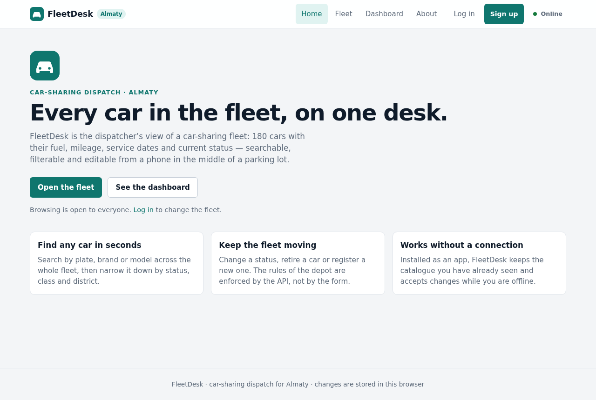 | 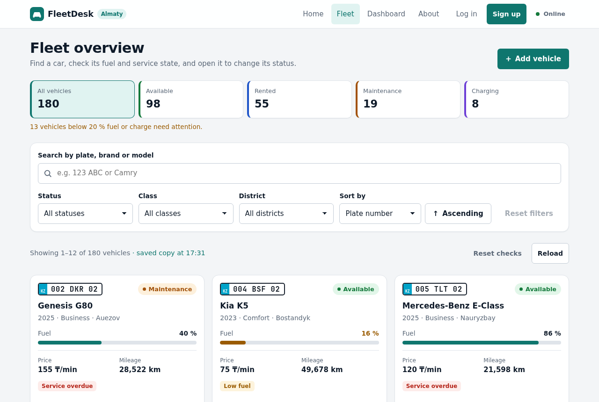 |

| Dashboard | Vehicle details |
| --- | --- |
| 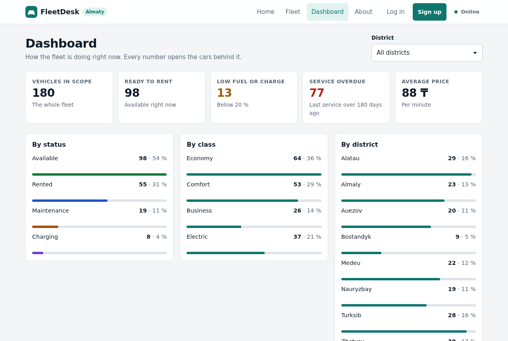 | 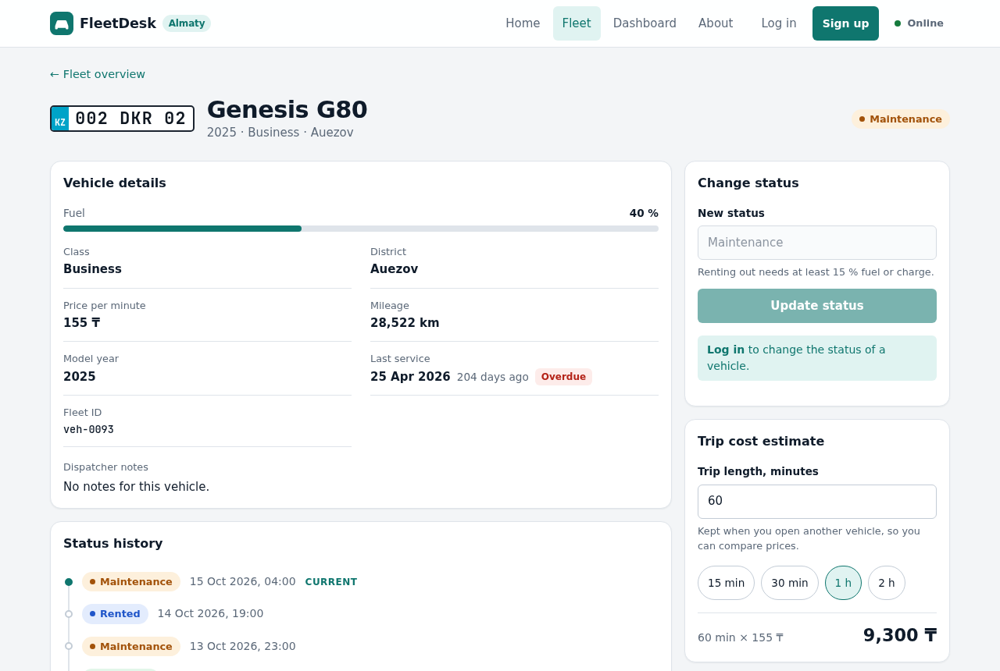 |

| Offline — the saved fleet | Offline page |
| --- | --- |
| 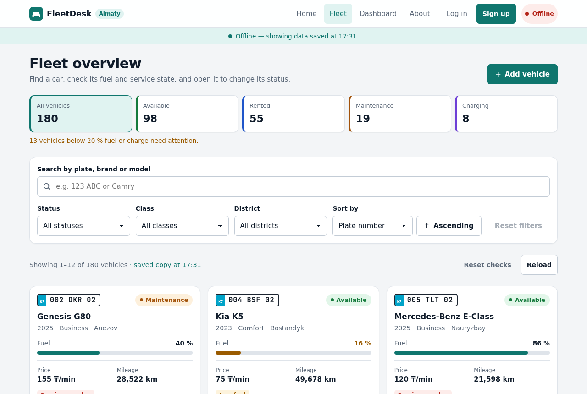 | 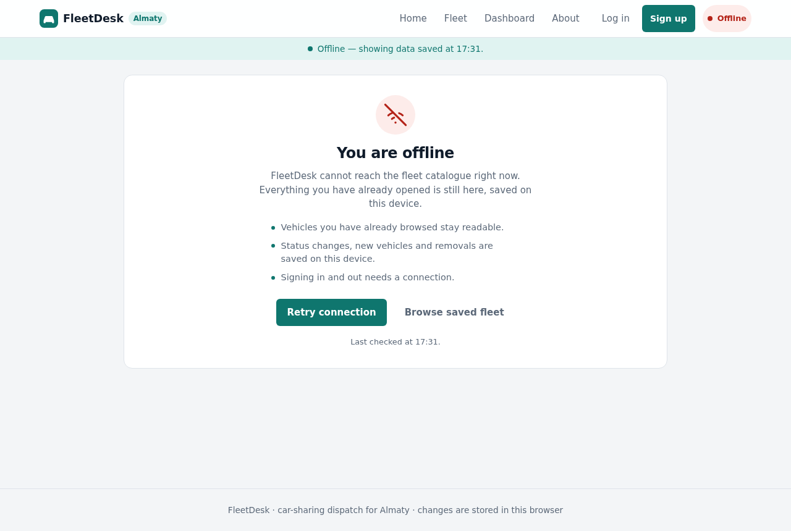 |

| Mobile (390 px) | Mobile menu | Dashboard at 320 px |
| --- | --- | --- |
| 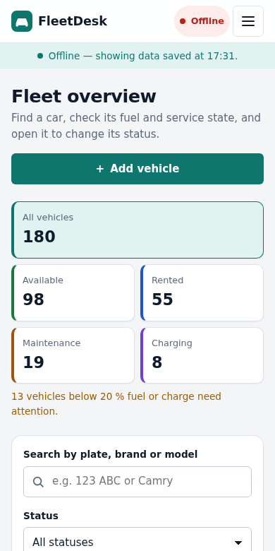 | 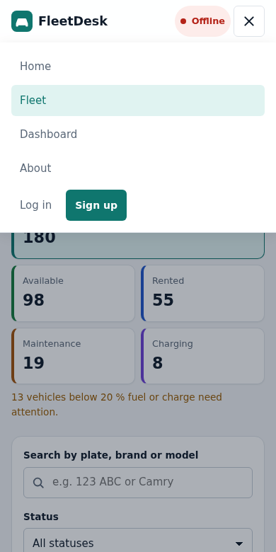 | 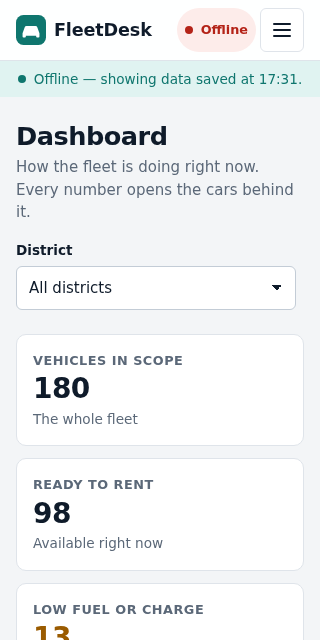 |

| Log in | Sign up | Add a vehicle (validation) |
| --- | --- | --- |
| 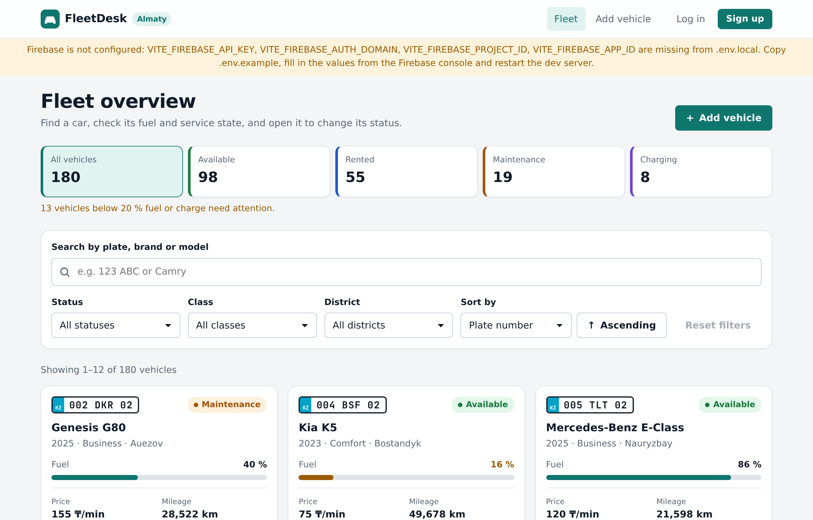 | 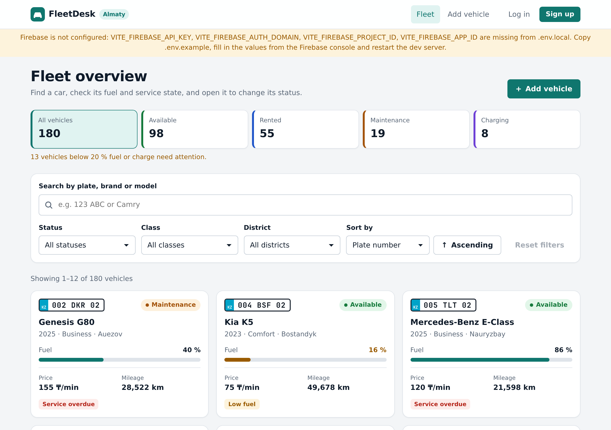 | 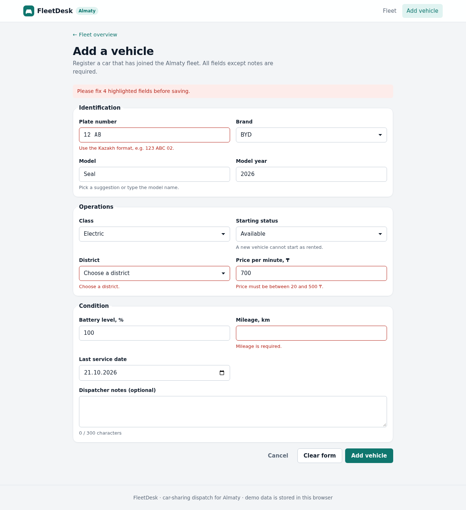 |

### Routes

| Route | Page | Access |
| --- | --- | --- |
| `#/` | Home | public |
| `#/about` | About the project and the author | public |
| `#/vehicles` | Fleet overview (list) | public |
| `#/vehicles/:id` | Vehicle details | public, actions need a login |
| `#/vehicles/new` | Add a vehicle | protected |
| `#/dashboard` | Fleet statistics | public |
| `#/login`, `#/signup` | Authentication | public |
| `#/profile` | Account | protected |
| `#/offline` | Connection status and what works offline | public |
| anything else | 404 | public |

`About`, `Dashboard`, `Add vehicle`, `Sign up`, `Profile` and `Offline` are **lazily loaded**
(`React.lazy` + `Suspense`), so the first visit downloads the landing page, the list and a vehicle —
nothing else.

**Home** (`#/`) — public
- What the application is for and the two places worth going first; the sign-in hint only appears
  when it is actionable (signed out and online).

**Fleet overview** (`#/vehicles`) — public
- Summary tiles with the number of cars per status; a tile also works as a one-click status filter.
- Search by plate, brand or model (debounced, 400 ms). Plates match with or without spaces: `123abc` finds `123 ABC 02`.
- Filters by **status**, **class** and **district**; sorting by plate, price per minute, fuel/charge, mileage, model year or last service date, ascending or descending.
- Pagination with 12 / 24 / 48 cars per page. Changing the search, a filter or the sort order returns to page 1.
- **The view lives in the URL** (`#/vehicles?q=camry&status=available&district=Medeu&sort=fuelLevel&dir=desc&page=2`),
  so a filtered list can be shared or bookmarked, survives a reload and walks correctly with
  Back/Forward. Typing and filtering use `replace`, so they do not fill the history stack.
- **Reload** refetches the list on demand; **Reset checks** clears the per-card shift checks.
- Each card carries its own **shift checks** — a tick and a note that stay on the card while the list
  is searched, filtered or re-sorted (the cards are keyed by vehicle id) and are cleared together by
  "Reset checks" (which changes that key).
- Loading, error (with **Retry**), empty (with **Reset filters**) and success states. While a new page loads, the previous results stay visible but dimmed.
- Every combination of filters the dispatcher has already opened comes back from the cache instantly,
  and the results line says when they come from a saved copy.

**Vehicle details** (`#/vehicles/:id`) — public, actions need a login
- All vehicle fields, days since the last service with an "Overdue" flag after 180 days, dispatcher notes.
- **Change status**: validated by the API (charging is only for electric cars; renting needs at least 15 % fuel/charge). The status history timeline updates immediately.
- **Remove from fleet**: two-click confirmation; a rented car has to come back first.
- **Trip cost estimate**: enter minutes or use a preset. The value is kept when you open another car, so prices can be compared.
- **Available cars of the same class in the same district**: replacement candidates, sorted by fuel level.
- Separate "Vehicle not found" state for unknown ids.

**Add a vehicle** (`#/vehicles/new`) — protected
- Fully controlled form with 12 fields grouped into sections.
- Validation messages appear next to fields after the field is left or on submit. Cross-field rules: a non-electric car cannot start as "charging" (the status falls back automatically), the service date cannot be in the future or before the model year.
- The API validates again and rejects duplicate plates; server errors are shown next to the relevant field and the entered data is kept.
- The submit button is locked while saving; on success the app opens the new car's page.

**Log in / Sign up** (`#/login`, `#/signup`) — public
- Email + password, or **Continue with Google** (popup).
- Sign-up asks for the password twice and checks the address, the length and that both copies match before Firebase is called.
- Firebase error codes are translated into readable sentences and shown next to the field they belong to.
- After a login the user lands on the page they originally wanted, not on a generic home page.

**Dashboard** (`#/dashboard`) — public
- Five statistics over the whole fleet: vehicles in scope, ready to rent, low fuel or charge,
  service overdue, average price per minute.
- Three breakdowns — by status, by class and by district — each row sized against the largest group.
- One interactive filter (district) that narrows every number and every breakdown; it is kept in the
  URL, so a district view can be shared.
- Every statistic and every row links to the fleet list filtered the same way.

**About** (`#/about`) — public
- What the project is and how it is built, plus the author section carried over from homework 2.

**Offline** (`#/offline`) — public
- Whether the connection is really available, what still works without it, and a **Retry connection**
  button that checks the network and returns to the previous page when it is back.

**Profile** (`#/profile`) — protected
- Email (with verification state), UID, sign-in method, account creation and last sign-in time, and a **Log out** button.

**Accessibility**: semantic landmarks, a `<label>` for every control, visible focus rings, `aria-live` regions for loading/results/errors, `aria-pressed` on toggle tiles and chips, `aria-current` on the current page, and `prefers-reduced-motion` support.

## Tech stack

- [React 18](https://react.dev/) (JavaScript + JSX), hooks only
- [React Router 7](https://reactrouter.com/) with a hash router (`createHashRouter`)
- [TanStack Query 5](https://tanstack.com/query/latest) for server-data caching, revalidation and invalidation
- [Firebase Authentication 13](https://firebase.google.com/docs/auth) — email/password and Google sign-in
- [Vite 8](https://vite.dev/) for the dev server, environment variables and the production build,
  plus two small plugins of this project: one builds the service worker, one keeps it out of the way in dev
- A hand-written **service worker** (no Workbox) for precaching, runtime caching and updates
- Plain CSS with custom properties (light and dark theme, mobile-first, 44 px touch targets)
- ESLint 9 with `eslint-plugin-react`, `eslint-plugin-react-hooks` and custom rules that forbid direct DOM access and index keys

No UI kits and no state-management library: the only global state is the authenticated user (React context) and the query cache.

## Getting started

Requirements: Node.js 20 or newer.

```bash
npm install
cp .env.example .env.local   # then fill in the Firebase values, see below
npm run dev                  # http://localhost:5173
```

The app runs without Firebase keys too: the fleet, filters and caching all work, a banner explains
which variables are missing, and only the sign-in screens are disabled.

| Script | What it does |
| --- | --- |
| `npm run api` | Generate the public catalogue into `public/api/` from `src/api/seed.js` |
| `npm run dev` | Generate the catalogue, then start the dev server with hot reload (**no service worker**) |
| `npm run build` | Generate the catalogue, then build the production bundle into `dist/` (service worker included) |
| `npm run preview` | Serve the production build locally (http://localhost:4173) — the way to test the PWA |
| `npm run lint` | Run ESLint; fails on any error or warning |

`public/api/` is generated, not authored: it is git-ignored and rebuilt by `predev` / `prebuild`.

### Environment variables

All configuration lives in `.env.local`, which is **git-ignored**; `.env.example` is the template
that is committed. Vite exposes to the browser only variables whose name starts with `VITE_`, and it
reads the file **once at startup** — restart the dev server after changing it.

| Variable | Where to find it |
| --- | --- |
| `VITE_FIREBASE_API_KEY` | Firebase console → Project settings → General → Your apps → SDK setup and configuration |
| `VITE_FIREBASE_AUTH_DOMAIN` | same screen (`<project-id>.firebaseapp.com`) |
| `VITE_FIREBASE_PROJECT_ID` | same screen |
| `VITE_FIREBASE_STORAGE_BUCKET` | same screen |
| `VITE_FIREBASE_MESSAGING_SENDER_ID` | same screen |
| `VITE_FIREBASE_APP_ID` | same screen |

They are read in exactly one place, `src/firebase.js`, which also reports which of them are missing.
These values are public by design — they identify the project, they do not grant access; access is
controlled by Firebase authorized domains and security rules.

### Setting up the Firebase project

1. Create a project at [console.firebase.google.com](https://console.firebase.google.com/) (Analytics is not needed).
2. **Build → Authentication → Get started**. On the **Sign-in method** tab enable:
   - **Email/Password**
   - **Google** (pick a support email; nothing else is required)
3. **Project overview → Add app → Web (`</>`)**, register the app and copy the `firebaseConfig` values into `.env.local`.
4. **Authentication → Settings → Authorized domains**: `localhost` is there already; add the deployed domain (e.g. `fleetdesk.vercel.app`) before testing Google sign-in in production.
5. Restart `npm run dev`. The warning banner disappears when all four required variables are set.

## Authentication

```
src/firebase.js          initializes the SDK from the VITE_ variables (and only it reads them)
src/services/authService.js  sign-up / sign-in / Google / sign-out / session subscription,
                             Firebase error codes → readable messages
src/context/AuthContext.js   the context object
src/context/AuthProvider.jsx the provider: subscribes to onAuthStateChanged, holds `user` and `status`
src/hooks/useAuth.js         the only way a component reads auth state
src/components/ProtectedRoute.jsx  gate in front of protected routes
```

- **Persistent sessions**: `browserLocalPersistence` is set before every sign-in, so a reload or a
  browser restart keeps the user signed in. `onAuthStateChanged` is the single source of truth — a
  login in another tab reaches this tab through the same subscription.
- **Loading state**: while Firebase restores the persisted session, `status` is `loading`.
  `ProtectedRoute` shows a spinner instead of deciding, which is what stops a signed-in user from
  being bounced to `/login` on every page reload.
- **Errors**: everything that leaves `authService.js` is an `AuthError` with a readable `message`
  and, where it makes sense, the `field` it belongs to (`auth/email-already-in-use` → the email
  field). Codes that mean a misconfigured project (`auth/operation-not-allowed`,
  `auth/unauthorized-domain`, `auth/api-key-not-valid`) say exactly what to fix in the console.
- **Who may do what**: browsing the fleet is public. Adding a vehicle (`/vehicles/new`) and the
  profile page are protected routes — an anonymous visitor is redirected to `/login` and sent back
  afterwards. Changing a status and removing a vehicle stay visible but disabled for anonymous
  visitors, with an inline "Log in to …" link, because a dispatch board should not let a random
  visitor move cars around.

## Server data and caching

> **Short version.** Every API answer is cached by TanStack Query under a key that contains the query
> parameters. A cached answer is served instantly and considered fresh for 60 seconds (30 for the
> counters); after that the next use triggers a background refetch, and unused entries are dropped
> after 5 minutes. Writes — create, status update, delete — invalidate every list, counter and
> "similar vehicles" entry, so no screen can keep showing data the write has just made wrong.

The cache lives in `src/queries/` + `src/hooks/useVehicleQueries.js`; no component calls the API itself.

**Query keys** (`src/queries/queryKeys.js`) are built by one factory, so the same key is never spelled twice:

| Key | Contents |
| --- | --- |
| `['vehicles', 'list', { search, status, class, district, sortBy, sortDir, page, pageSize }]` | one page of the fleet list |
| `['vehicles', 'detail', 'veh-0007']` | one vehicle |
| `['vehicles', 'stats', { district }]` | the summary counters and the dashboard |
| `['vehicles', 'similar', { vehicleClass, district }]` | replacement candidates |

Because the parameters are *inside* the key, each filter combination is its own cache entry: going
back to a filter or a page the dispatcher has already seen renders from memory with no request.

**Expiration and revalidation** (`src/queries/queryClient.js`):

| Setting | Value | Why |
| --- | --- | --- |
| `staleTime` | 60 s (30 s for the counters) | How long an answer is reused without asking the API again |
| `gcTime` | 5 min | How long an unused entry stays in memory before it is dropped |
| `refetchOnWindowFocus` / `refetchOnReconnect` | on | A *stale* entry is refreshed in the background when the tab regains focus or the network comes back; a fresh one is not |
| `retry` | 1 extra attempt, 5xx only | 4xx (404, 409, 422) is the server's final word — retrying only wastes a round-trip |

**Invalidation — when cached data is thrown away:**

| Operation | What happens to the cache |
| --- | --- |
| `createVehicle` | The created vehicle is written into `['vehicles','detail',id]` (so its page opens with no request), then **all** `['vehicles','list']`, `['vehicles','stats']` and `['vehicles','similar']` entries are invalidated — any page of any filter may now be missing a car |
| `updateVehicleStatus` | The updated vehicle replaces its `detail` entry; lists, counters and "similar" are invalidated because the car may have moved into or out of their filters |
| `deleteVehicle` | The `detail` entry is **removed** (the entity is gone, not stale), lists, counters and "similar" are invalidated, and the user is sent back to the list |

Invalidated entries are not refetched blindly: TanStack Query marks them stale and refetches only the
ones a mounted component is actually watching — the rest refetch the next time they are opened.

**Outdated answers can never overwrite newer ones.** Three mechanisms, all in
`src/hooks/useVehicleQueries.js`:

1. The `signal` React Query provides is passed to the API. When the key changes (new page, new
   filter) the previous request is aborted, and its answer is discarded even if it arrives later.
2. An answer belongs to the key it was requested with, so a late reply to filter *A* is written to
   *A*'s cache entry — never to the entry the user is looking at now.
3. Before a status update the mutation calls `cancelQueries` on that vehicle: a `GET` already in
   flight would otherwise land *after* the update and put the old status back on screen.

On top of that, the list uses `placeholderData: keepPreviousData`, so switching page or filter keeps
the previous results on screen (dimmed, with an "Updating…" note) instead of flashing a spinner.

## Progressive web app

> **Short version.** The application shell is precached on install, the public catalogue is cached
> stale-while-revalidate and static assets cache-first. A new deployment never swaps itself in behind
> the user's back: it waits, a toast offers the update, and one click activates it and reloads the
> page. Offline, previously visited pages and previously fetched data keep working, changes are still
> accepted, and the connection state is measured instead of guessed.

### Installation

`public/manifest.webmanifest` declares `name`, `short_name`, `start_url: "./"`, `scope: "./"`,
`display: "standalone"`, `theme_color`, `background_color`, two shortcuts and three icons: 192×192,
512×512 and a 512×512 maskable one (generated from `public/icons/icon.svg`). It is linked from
`index.html`, next to the iOS metas and the 180×180 `apple-touch-icon` — iOS ignores the manifest for
installation, where the user adds the app from the Share menu.

Chrome offers installation once the manifest is valid, the icons load and a service worker with a
`fetch` handler controls the page; all three hold for a production build.

### Service worker lifecycle

`src/sw/sw.js` is written by hand — no Workbox — and built by `plugins/vite-plugin-service-worker.js`,
which substitutes three values into it during `generateBundle` and emits it unhashed at the root of
`dist/` (a worker cannot control anything above its own URL):

| Placeholder | Becomes |
| --- | --- |
| the precache manifest | the hashed build output plus the shell files from `public/`, as **relative** paths (`base: './'` must keep working in a sub-folder) |
| the version | `package.json` version + a SHA-256 of that manifest — an unchanged rebuild produces a byte-identical `sw.js`, so there are no phantom "update available" prompts |
| the contract | the shared constants from `src/pwa/swContract.js`, so the worker and the app can never disagree about a header name or a path |

| Event | What happens |
| --- | --- |
| `install` | `cache.addAll` of the shell — all-or-nothing, so a broken deploy never half-installs — then a best-effort warm-up of `api/fleet.json` outside the critical path, so the first offline visit already has the whole fleet. `skipWaiting()` is **never** called here. |
| `activate` | Deletes every `fleetdesk-*` cache that is not in use, sweeps expired entries, then `clients.claim()`. |
| `fetch` | Strategy routing, in the order below. |
| `message` | `SKIP_WAITING` (sent by the update toast) and `SWEEP_CACHES`. |

### Caches

| Cache | Strategy | Holds | Lifetime |
| --- | --- | --- | --- |
| `fleetdesk-precache-<version>` | precache, cache-first | `index.html`, every built JS/CSS chunk, `offline.html`, the manifest and the install icons | replaced on every deploy |
| `fleetdesk-api-v1` | **stale-while-revalidate** | `api/fleet.json` and `api/vehicles/<id>.json` | survives deploys; max 80 entries, swept after 7 days |
| `fleetdesk-assets-v1` | **cache-first** | images, icons and fonts loaded at runtime (`icon.svg`, `favicon.svg`, …) | survives deploys; max 60 entries, swept after 30 days |

The runtime caches carry a *schema* version (`-v1`), not the build version, on purpose: versioning
them would wipe the user's offline data on every update, which is exactly what the assignment forbids.
Size is capped two ways — `trimCache` drops the oldest entries after every write (`cache.keys()` is in
insertion order, and a revalidated entry moves to the back, so it behaves like LRU for anything in
active use), and `sweepExpired` deletes anything older than the budget on activation. An expired entry
is never *refused* while it is still there: stale data beats a blank screen.

### The fetch handler, rule by rule

1. **Not a GET** → untouched. Mutations and Firebase POSTs never enter a cache.
2. **A range request** → untouched; a 206 cannot be replayed correctly.
3. **Firebase / Google hosts** → untouched, and deliberately *without* `respondWith`, which preserves
   credentials and the sign-in popup's opener. Authentication responses, tokens and user data are
   never cached.
4. **Any other cross-origin request** → untouched.
5. **`ping.txt`** → untouched: the connectivity probe only means something if it reaches the network.
6. **Page navigation** → the precached shell (matched by its `index.html` key, because the request is
   for `/`), falling back to the precached `offline.html` when even that is gone. Cache-first, not
   network-first: a fresh `index.html` next to an old precache would reference chunks that no longer
   exist.
7. **`api/…`** → stale-while-revalidate.
8. **Scripts, styles, images, fonts** → cache-first.
9. **Anything else same-origin** → network, with the cache as a safety net.

Two details that are easy to get wrong and are handled explicitly:

- **`ignoreVary: true` on every cache read.** Vite marks its script and link tags `crossorigin`, so the
  document requests them in CORS mode with an `Origin` header, while the worker's precache request had
  none. Static hosts answer assets with `Vary: Origin`, and Vary-aware matching then misses on exactly
  the files the app cannot start without.
- **Only JSON answers are rebuilt.** Adding a header means constructing a new `Response`, which loses
  the response's URL — and a JavaScript module without a response URL cannot resolve its own relative
  imports, so the lazily loaded pages would fail offline. Scripts, styles and images are served
  untouched; their age comes from the server's `Date` header.

### "You are viewing cached data"

When the worker answers from a cache it adds `X-Served-From: sw-cache` and `X-Cached-At`.
`src/api/http.js` — the single place in the app that calls `fetch` — reads both, records them in
`src/services/cacheStatusStore.js`, and `useCacheStatus` exposes them to React through
`useSyncExternalStore`. The result is visible in two places: the results line of the fleet list
(`· saved copy at 14:32`) and an app-wide banner that appears when the copy is being shown offline or
is more than five minutes old.

### Updates

`src/pwa/registerSW.js` registers the worker at **module scope** (an effect would register twice under
StrictMode) with `updateViaCache: 'none'`, and listens for `updatefound` → `statechange`. When a new
worker reaches `installed` while a controller already exists, the update is announced through
`swUpdateStore` and `UpdateToast` offers it. "Update now" posts `SKIP_WAITING`; the resulting
`controllerchange` reloads the page exactly once (a module-level guard, plus a `hadController` check so
a first install never reloads). Open tabs re-check for updates when they become visible again and once
an hour. Nothing needs to be cleared by hand: the old precache is deleted on activation, while the API
and asset caches are kept.

### Offline

- **Detection** (`src/services/connectivityService.js`): `navigator.onLine === false` is trusted as a
  negative; a positive is proven by fetching the one-byte `ping.txt` with `cache: 'no-store'` and a
  3-second timeout, and by the app's own traffic — every successful network answer and every network
  failure in `src/api/http.js` updates the state. While offline it retries with a 5 s → 60 s backoff;
  while online it does not poll at all. TanStack Query's `onlineManager` is wired to the same source,
  and queries run in `networkMode: 'offlineFirst'` so the worker gets a chance to answer them.
- **What works**: the shell and every visited page start from the precache; the fleet list, the
  dashboard and any vehicle come from the cached catalogue; a vehicle whose own file was never fetched
  falls back to the catalogue; status changes, new vehicles and removals are written to this browser's
  overlay and are still accepted. Signing in and out needs a connection.
- **The offline page**: `#/offline` inside the app, and `public/offline.html` as the worker's last
  resort for a navigation it cannot serve — a self-contained document with no dependency on the bundle,
  for the case where the shell itself was evicted.

### Testing it

The service worker is **disabled in `npm run dev`**: there is no precache manifest before a build, and
a caching worker fights HMR. In dev, `/sw.js` answers with a worker that unregisters itself and clears
this app's caches, so a worker installed earlier by `vite preview` on the same port cannot haunt the
dev server.

```bash
npm run build && npm run preview     # http://localhost:4173
```

1. **Application → Manifest** — installable, icons present. **Install** from the address bar.
2. **Application → Service Workers** — one worker, *activated and running*.
3. **Application → Cache Storage** — `fleetdesk-precache-<version>`, `fleetdesk-api-v1`,
   `fleetdesk-assets-v1`. Open a few vehicles and watch the API cache fill.
4. **Network → Offline**, then reload: the app starts, the fleet is there, the header shows
   *Offline* and a banner says when the data was saved. Open a vehicle you never opened — it still
   works, from the catalogue. Go to a page you have not visited — it loads, because the chunk is
   precached.
5. Build again after a change, reload: a toast offers the new version; pressing **Update now** reloads
   on it, and the old precache disappears while the API cache stays.

## Project structure

```
.
├── docs/                       # homework checklists, decisions, defense guide, screenshots
├── plugins/
│   ├── vite-plugin-service-worker.js   # builds dist/sw.js: precache manifest, version, contract
│   └── vite-plugin-sw-dev-killer.js    # dev-only: /sw.js unregisters any leftover worker
├── scripts/build-api.mjs       # generates public/api/ from the seed
├── public/
│   ├── api/                    # generated: fleet.json + vehicles/<id>.json (git-ignored)
│   ├── icons/                  # icon.svg + 192 / 512 / maskable / apple-touch PNGs
│   ├── manifest.webmanifest    # installability
│   ├── offline.html            # the worker's last-resort page, independent of the bundle
│   ├── ping.txt                # one byte, never cached: the connectivity probe
│   └── favicon.svg
├── src/
│   ├── api/
│   │   ├── endpoints.js        # URLs built against the document, so base: './' keeps working
│   │   ├── http.js             # the only fetch() in the app: errors, cache headers, connectivity
│   │   ├── network.js          # simulated latency, AbortSignal support, ApiError, ?simulateError
│   │   ├── overlay.js          # this browser's changes, merged over the catalogue (localStorage)
│   │   ├── seed.js             # deterministic generator of the 180 vehicles
│   │   └── vehiclesApi.js      # listVehicles, getVehicle, getFleetStats, createVehicle, updateVehicleStatus, deleteVehicle
│   ├── components/             # reusable UI: VehicleCard, FilterPanel, Pagination, VehicleForm,
│   │   │                       # StatBreakdown, ConnectionStatus, UpdateToast, CachedDataBanner, ...
│   ├── context/
│   │   ├── AuthContext.js / AuthProvider.jsx            # session subscription and auth actions
│   │   └── ConnectivityContext.js / ConnectivityProvider.jsx   # one connection state for the app
│   ├── hooks/
│   │   ├── useAuth.js, useConnectivity.js               # read the two contexts
│   │   ├── useCacheStatus.js, useServiceWorkerUpdate.js # read the two external stores
│   │   ├── useDebouncedValue.js, useSessionState.js
│   │   └── useVehicleQueries.js  # every query and mutation of the app
│   ├── pages/                  # HomePage, AboutPage, VehiclesPage, VehicleDetailsPage,
│   │                           # NewVehiclePage, DashboardPage, LoginPage, SignupPage,
│   │                           # ProfilePage, OfflinePage, NotFoundPage
│   ├── pwa/
│   │   ├── registerSW.js       # registration, update detection, single-reload guard
│   │   ├── swContract.js       # constants shared by the app, the worker and the build
│   │   └── swUpdateStore.js    # bridges the registration into React
│   ├── queries/                # queryClient.js (cache defaults), queryKeys.js (the key factory)
│   ├── services/
│   │   ├── authService.js      # Firebase Auth wrapper
│   │   ├── cacheStatusStore.js # where the last answer for a URL came from
│   │   └── connectivityService.js  # probe + events + traffic signals + backoff
│   ├── sw/sw.js                # the service worker (source; built into dist/sw.js)
│   ├── styles/                 # tokens, base, layout, components, pages, auth, pwa
│   ├── utils/                  # constants, formatting, validation (vehicle + auth), helpers
│   ├── data/profile.js         # the About page's author section (from homework 2)
│   ├── firebase.js             # reads VITE_ variables, initializes the SDK
│   ├── App.jsx                 # providers + router configuration (with the lazy routes)
│   └── main.jsx                # React root + service worker registration
├── .env.example                # template for .env.local (committed)
├── eslint.config.js
├── index.html
├── vercel.json                 # build settings + cache headers for sw.js, the manifest and the API
└── vite.config.js
```

**Layering rule**: UI components never touch `localStorage`, `fetch`/the API or the Firebase SDK
directly. They call hooks (`useAuth`, `use*Query`, `use*Mutation`); the hooks call services
(`vehiclesApi.js`, `authService.js`); only the services touch storage, the network and Firebase.

## The data layer: a public catalogue and a local overlay

A service worker can only cache what travels over HTTP, and the simulated API of the earlier
homeworks kept its data in `localStorage`, where no worker can see it. So the data moved out into real
files, and the simulated API stayed exactly where it was — on top of them.

```
public/api/fleet.json              the whole catalogue: { generatedAt, count, vehicles[] }   ← the "list" request
public/api/vehicles/veh-0001.json  one vehicle                                               ← the "details" request
```

Both are generated by `scripts/build-api.mjs` from the same deterministic seed as before
(`src/api/seed.js`, fixed PRNG seed, 180 vehicles), so every visitor still starts with an identical
fleet, and the files are rebuilt before `dev` and `build`.

**What the dispatcher changes stays in this browser.** `src/api/overlay.js` keeps created, edited and
removed vehicles in `localStorage` under `fleetdesk.overlay` and merges them over the fetched
catalogue. Two things follow: the fleet remains editable with no connection at all, and redeploying
the catalogue never silently discards the user's own work.

`src/api/vehiclesApi.js` behaves like a small REST backend on top of that:

| Method | Returns | Notes |
| --- | --- | --- |
| `listVehicles(params, { signal })` | `{ items, total, page, pageSize, meta }` | Search, filters, sorting and pagination happen here, not in components |
| `getVehicle(id, { signal })` | vehicle | Fetches `api/vehicles/<id>.json`; a local edit wins, and when that file cannot be reached the vehicle is taken from the cached catalogue. `404` for an unknown id |
| `getFleetStats(params, { signal })` | `{ total, byStatus, byClass, byDistrict, lowFuel, serviceOverdue, averagePricePerMinute, meta }` | Feeds the summary tiles and the dashboard; `params.district` narrows every number |
| `createVehicle(data)` | created vehicle | `422` with `fieldErrors` on invalid data, `409` on a duplicate plate |
| `updateVehicleStatus(id, status)` | updated vehicle | `422` when a business rule is broken, appends to `statusHistory` |
| `deleteVehicle(id)` | `{ id }` | `404` for an unknown id, `409` when the car is currently rented |

`listVehicles` params: `search`, `status`, `vehicleClass`, `district` (each filter accepts `'all'`),
`sortBy` (`plate`, `pricePerMinute`, `fuelLevel`, `mileageKm`, `year`, `lastServiceDate`), `sortDir` (`asc` / `desc`),
`page` (from 1) and `pageSize` (1–48). `meta` carries `{ fromCache, cachedAt }` — where the answer came from.

How it still behaves like a real server:
- **Latency**: every call waits a random 400–900 ms before the request goes out.
- **Cancellation**: read methods accept an `AbortSignal`, which is passed to `fetch` as well; aborting rejects with a `DOMException` named `AbortError`. React Query passes a signal to every query, so outdated requests are aborted automatically.
- **Errors**: `ApiError` with a status, optional `fieldErrors`, and `offline: true` when the request never reached the network — which is what turns a dead connection into a "Retry connection" message instead of a generic failure.
- **Copies**: responses are deep copies, so the UI can never mutate the stored data by accident.
- **Resetting**: `localStorage.removeItem('fleetdesk.overlay')` in the console restores the published catalogue; bumping `SCHEMA_VERSION` in `src/api/overlay.js` does it for every browser.

### Simulating errors: `?simulateError`

Add the `simulateError` query parameter to the URL to test the error states:

| URL | Effect |
| --- | --- |
| `http://localhost:5173/?simulateError=1#/` | every API request fails with a 500 error |
| `http://localhost:5173/?simulateError=0.3#/` | about 30 % of requests fail (good for trying **Retry**) |
| `http://localhost:5173/#/vehicles/veh-0001?simulateError=1` | the parameter also works inside the hash route |

A yellow banner under the header shows that the mode is on. Remove the parameter to turn it off.

## Mobile

The layout is mobile-first and tested from **320 px** upwards, in portrait and landscape.

- **Navigation** collapses below 768 px into a menu button: `aria-expanded` + `aria-controls`, focus
  moves into the panel when it opens, Escape closes it and returns focus to the button, a backdrop
  closes it on a tap outside, and any navigation closes it. Above 768 px it is an ordinary row of links.
- **Touch targets** come from one token: `--control-height` is 44 px, and only a precise pointer
  (`@media (pointer: fine)`) gets the tighter 40 px. Buttons, inputs, selects, chips, pagination
  controls and navigation links all follow it.
- **No horizontal scrolling**: the header wraps instead of overflowing, text blocks carry `min-width: 0`,
  the card grid is `repeat(auto-fill, minmax(min(100%, 280px), 1fr))`, and page actions become
  full-width buttons on narrow screens.
- **Height**: `100svh` (with `100vh` as the fallback) so the layout does not jump when a mobile
  browser hides its address bar; `env(safe-area-inset-bottom)` keeps the update toast clear of the
  home indicator.
- Everything works on a phone, not just fits on one: filtering, sorting, pagination, the form, the
  dashboard and the status controls are all usable with a thumb.

## Deployment (Vercel)

The build is a static site. Thanks to `base: './'` in `vite.config.js` and hash-based URLs
(`/#/vehicles/veh-0001`), the same `dist/` folder works at a domain root or in a sub-folder,
with no server rewrite rules.

```bash
git remote add origin https://github.com/<your-user>/<your-repo>.git
git push -u origin main
```

1. Sign in at [vercel.com](https://vercel.com/) with GitHub, click **Add New → Project** and import the repository.
2. Vercel detects Vite (`vercel.json` pins the build command `npm run build` and the output directory `dist`).
3. Open **Environment Variables** and add all six `VITE_FIREBASE_*` values for *Production*, *Preview*
   and *Development*. `.env.local` is not in the repository, so without this step the deployed app
   starts in the "Firebase is not configured" mode.
4. **Deploy**, then open the `https://<project>.vercel.app` link.
5. Add that domain in **Firebase console → Authentication → Settings → Authorized domains**,
   otherwise Google sign-in fails there with `auth/unauthorized-domain`.

Changing an environment variable on Vercel needs a **redeploy**: the values are baked into the bundle at build time.

`vercel.json` also sets the cache headers the service worker depends on:

| Path | `Cache-Control` | Why |
| --- | --- | --- |
| `/sw.js` | `max-age=0, must-revalidate` | A long-cached worker would freeze users on an old version with no way back |
| `/manifest.webmanifest`, `/offline.html` | `max-age=0, must-revalidate` | They must be able to change between deploys |
| `/api/*` | `max-age=0, must-revalidate` | The worker does the caching; the HTTP cache must not hide updates from it |
| `/ping.txt` | `no-store` | The probe only means something when it reaches the server |
| `/assets/*` | `max-age=31536000, immutable` | Hashed filenames never change content |

### Checklist after deploying

- [ ] The fleet list, filters, sorting and pagination work; a filtered URL can be shared.
- [ ] Sign up with an email, reload the page — you are still signed in.
- [ ] Log out, then log in with Google.
- [ ] Open `#/profile` in a private window — you are redirected to `#/login`.
- [ ] Add a vehicle — it appears in the list and in the counters without a manual refresh.
- [ ] The browser offers to **install** the app; installed, it opens without browser chrome.
- [ ] With the device in flight mode, the installed app still opens, shows the fleet and says the
      data is a saved copy.
- [ ] Deploy again — open tabs offer the update and take it without anything being cleared by hand.
